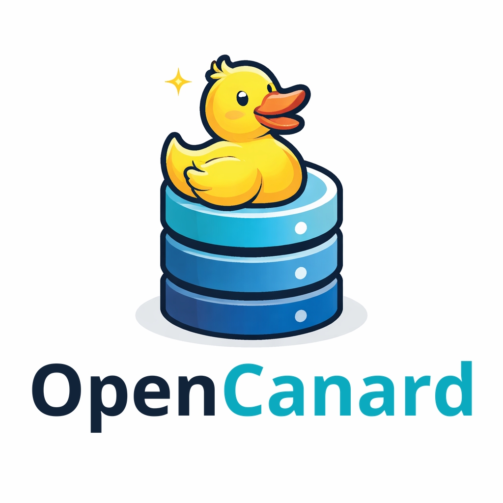

<p align="center">
  
</p>

# OpenCanard

**OpenCanard** is an open-source, self-hosted [DuckDB](https://duckdb.org) server for remote analytics.
It exposes SQL execution over [Apache Arrow Flight](https://arrow.apache.org/docs/format/Flight.html), so Python, Java and BI tools can query Parquet files and S3-compatible object storage without relying on a managed cloud service.

> **Status: early development (v0.1).** The core query path works, but several security features are not
> finished yet (no TLS, weak token validation on the Flight port). Read
> [docs/authentication.md](docs/authentication.md) before exposing a server to any network you do not fully trust.

## What OpenCanard is

- A **self-hosted server** that puts DuckDB behind an Arrow Flight endpoint.
- A **remote query engine**, not a full database platform.
- Aimed at **read-only analytics** workloads.
- Lightweight, minimal and easy to audit.
- Suited to environments that cannot or do not want to send data to managed services.

## What OpenCanard is not

- A replacement for DuckDB itself.
- A SaaS or managed service.
- A multi-tenant analytics platform.
- A metadata catalog or lakehouse.
- A query scheduler, workflow engine or visualization tool.
- A platform for transactional workloads (OLTP).

## Features

- Remote execution of DuckDB queries, with results streamed as Arrow record batches.
- Python access through PyArrow Flight.
- A JDBC driver for Java and BI tools (`SELECT` only).
- Parquet and S3-compatible storage through DuckDB.
- Single-tenant deployments.
- User accounts stored in a metadata database, with bcrypt-hashed passwords.
- A small REST management API with OpenAPI/Swagger documentation.

## Repository layout

| Path | Contents |
| --- | --- |
| [`opencanard-server/`](opencanard-server) | The Flight server and REST API. Builds a distributable zip. |
| [`opencanard-jdbc-driver/`](opencanard-jdbc-driver) | The JDBC driver (shaded `-all` jar). |
| [`docs/`](docs) | Configuration, authentication, REST API and client guides. |
| [`resources/`](resources) | Logo and icons. |

Both modules are built from the parent [`pom.xml`](pom.xml) (Java 17, Apache Arrow 18.3.0).

## Getting started

### 1. Build

```bash
mvn package
```

This produces:

- `opencanard-server/target/opencanard.zip` — the server distribution.
- `opencanard-jdbc-driver/target/opencanard-jdbc-driver-0.1-all.jar` — the JDBC driver.

### 2. Start the server

Unzip the distribution and run the start script:

```bash
unzip opencanard-server/target/opencanard.zip
cd opencanard
bin/start.sh          # bin\start.bat on Windows
```

The Flight server listens on port `8815` and the REST API on `8084` by default.
See [docs/configuration.md](docs/configuration.md) to change them.

### 3. Create a user

The server does not create its user table for you yet. Create it once in the metadata database
(`metadata/metadata.duckdb`) and add an administrator. The full steps, including how to generate
the bcrypt hash, are in [docs/authentication.md](docs/authentication.md#creating-users).

### 4. Query it

**Python** (PyArrow Flight):

```python
import base64
import pyarrow.flight as flight

client = flight.FlightClient("grpc://localhost:8815")

credentials = base64.b64encode(b"admin:change-me").decode()
options = flight.FlightCallOptions(
    headers=[(b"authorization", f"Basic {credentials}".encode())]
)

descriptor = flight.FlightDescriptor.for_command(b"SELECT 42 AS answer")
info = client.get_flight_info(descriptor, options)
table = client.do_get(info.endpoints[0].ticket, options).read_all()
print(table.to_pandas())
```

**Java / BI tools** (JDBC): add the `-all` jar to the tool, use the driver class
`io.opencanard.driver.jdbc.OpenCanardDriver` and a URL such as `jdbc:opencanard://localhost:8815`.
Details are in [docs/clients.md](docs/clients.md).

## Documentation

- [Configuration](docs/configuration.md) — properties, directories and JVM options.
- [Authentication and security](docs/authentication.md) — users, tokens, TLS and known limitations.
- [REST API](docs/rest-api.md) — health, login and management endpoints.
- [Clients](docs/clients.md) — Python and JDBC usage.

## License

OpenCanard is released under the [Apache License 2.0](LICENSE).
